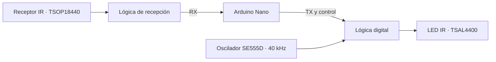

<h1 align="center">📡 PCB de 4 capas · Arduino Nano + Infrarrojos</h1>

  Del esquema eléctrico a una placa preparada para su revisión y fabricación.
   
  <strong>Proyecto académico · EITE · Universidad de Las Palmas de Gran Canaria</strong>

  
  
  
  

✨ ¿De qué trata el proyecto?
Diseño de una placa de circuito impreso (PCB) de cuatro capas con Arduino Nano, conectores de expansión y un sistema de transmisión y recepción por infrarrojos.

El circuito integra un oscilador de aproximadamente 40 kHz basado en un temporizador SE555D, lógica digital para controlar las señales y una etapa emisora y receptora de infrarrojos.
🔁 Diagrama de bloques

🧩 Componentes principales
Bloque	Componentes / función
🧠 Control	Arduino Nano y conectores de expansión
⏱️ Oscilador	SE555D, señal de ~40 kHz
📤 Emisor IR	LED TSAL4400 y transistor MMBT2222A
📥 Receptor IR	TSOP18440
🔀 Lógica digital	74LVC2G86 y 74LVC2G08
⚡ Alimentación	Redes de 5 V, 3,3 V y masa

🎨 Diseño de la PCB
Capa	Uso principal
🔴 TOP	Pistas y conexiones de la cara superior
🟢 GND	Plano interno de masa
🟠 POWER	Distribución de alimentación
🔵 BOTTOM	Pistas y conexiones de la cara inferior

La PCB incluye conectores, taladros de fijación, serigrafía y planos de cobre.
✅ Comprobaciones realizadas
- DRC de KiCad: 0 errores y 0 avisos en la última comprobación indicada.
- Archivos de fabricación: Gerber de las cuatro capas, máscaras, serigrafías y contorno.
- Taladrado: archivos PTH y NPTH generados.
- Montaje: archivo CSV de posición de componentes generado.
- Documentación: esquemas y capas de la PCB exportados a PDF.
[!IMPORTANT]
Antes de fabricar la PCB, hay que revisar los Gerber en el visor del fabricante y confirmar la compatibilidad de las huellas, la colocación de los conectores y los modelos 3D.

📂 Organización del repositorio
Practica_Diseno_PCB/
├── Práctica_Diseño_PCB.kicad_pro    # Proyecto KiCad
├── Práctica_Diseño_PCB.kicad_sch    # Esquema principal
├── Práctica_Diseño_PCB.kicad_pcb    # Diseño de la placa
├── arduino.kicad_sch               # Arduino y expansión
├── oscilador.kicad_sch             # Oscilador de 40 kHz
├── IR_Tx_Rx.kicad_sch              # Transmisor y receptor IR
├── alimentaciones.kicad_sch       # Alimentaciones
├── Fabricacion_PCB/                # Gerber y taladrado
├── Archivos de Montaje_PCB/        # Posiciones de componentes
├── Documentacion_PDF/              # PDF del esquema y la placa
└── README.md
La estructura muestra los archivos principales; los nombres de las carpetas de documentación pueden variar según la entrega.

🚀 Cómo abrir el proyecto
1. Instala KiCad 9 o una versión compatible.
2. Descarga o clona el repositorio.
3. Abre Práctica_Diseño_PCB.kicad_pro.
4. Desde el gestor de KiCad, abre el Editor de esquemas o el Editor de placas.
5. Si utilizas bibliotecas o modelos 3D personalizados, comprueba que sus rutas sean correctas.
🏭 Archivos de fabricación y montaje
En Fabricacion_PCB/ se incluyen los archivos necesarios para revisar la fabricación de la placa, entre ellos:
- Cobre: TOP, GND, POWER y BOTTOM.
- Máscara de soldadura y serigrafía de ambas caras.
- Pasta de soldadura superior e inferior.
- Contorno Edge.Cuts.
- Taladros PTH y NPTH.
El archivo de posición de componentes se encuentra en la carpeta de montaje. La BOM y el presupuesto de 10 y 100 placas forman parte de la documentación del proyecto, cuando se incluyan en el repositorio.
🎓 Contexto académico
Proyecto desarrollado para una práctica de diseño de circuitos impresos de la Escuela de Ingeniería de Telecomunicación y Electrónica (EITE) de la Universidad de Las Palmas de Gran Canaria (ULPGC).

<strong>🛠️ Diseñado con KiCad · 📡 Comunicación infrarroja · 🧠 Arduino Nano</strong>

