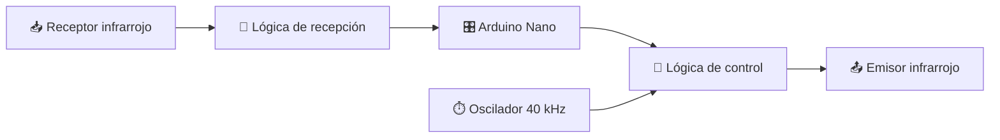

🚀 PCB de 4 capas · Arduino Nano + Infrarrojos
🔌 Del esquema eléctrico a una placa lista para revisar y fabricar

Universidad de Las Palmas de Gran Canaria · EITE
Diseño de circuitos impresos con KiCad 9

✨ ¿De qué trata el proyecto?
Diseño de una PCB de cuatro capas que integra un Arduino Nano, conectores de expansión y un sistema de transmisión y recepción por infrarrojos. Incluye un oscilador de aproximadamente 40 kHz basado en el temporizador 555, lógica digital y circuitos de alimentación.
🧩 Así funciona a grandes rasgos

💡 Objetivo: pasar de un esquema jerárquico a una PCB enrutada, documentada y preparada para entregar sus archivos de fabricación y montaje.

🛠️ Componentes destacados
Bloque	Componentes / función
🧠 Control	Arduino Nano y conectores de expansión
⏱️ Oscilador	SE555D, ~40 kHz
📡 Transmisión IR	LED TSAL4400, transistor MMBT2222A y lógica digital
👀 Recepción IR	TSOP18440 y lógica de recepción
⚡ Alimentación	Redes de 5 V y 3,3 V, condensadores de desacoplo

🧱 Diseño de la PCB
Capa	Función
🔴 TOP	Pistas y conexiones de la cara superior
🟢 GND	Plano interno de masa
🟠 POWER	Distribución interna de alimentación
🔵 BOTTOM	Pistas y conexiones de la cara inferior

✅ Verificaciones realizadas
- DRC de KiCad: 0 errores y 0 avisos en la última comprobación realizada.
- Archivos Gerber y taladrado PTH/NPTH generados.
- Archivo CSV de posición de componentes generado.
- BOM y presupuestos de 10 y 100 placas preparados.
⚠️ El DRC no sustituye la revisión final de Gerber, modelos 3D y restricciones del fabricante. Los costes del presupuesto son estimaciones sujetas a transporte, aduanas e impuestos aplicables.

📁 ¿Qué encontrarás en el repositorio?
📦 Practica_Diseno_PCB/
├── 📄 Práctica_Diseño_PCB.kicad_pro     # Proyecto KiCad
├── 📄 Práctica_Diseño_PCB.kicad_sch     # Esquema jerárquico principal
├── 📄 Práctica_Diseño_PCB.kicad_pcb     # Diseño de la PCB
├── 📄 arduino.kicad_sch                # Arduino y expansión
├── 📄 oscilador.kicad_sch              # Oscilador de 40 kHz
├── 📄 IR_Tx_Rx.kicad_sch               # Comunicación infrarroja
├── 📄 alimentaciones.kicad_sch         # Alimentaciones
├── 📁 Fabricacion_PCB/                 # Gerber + PTH/NPTH
├── 📁 Archivos de Montaje_PCB/         # Posiciones de componentes
└── 📁 Documentacion_PDF/               # PDFs del proyecto (si se suben aquí)
Además: listas de materiales (BOM) y presupuesto en Excel, según los archivos que se incorporen al repositorio. Si se usan bibliotecas o modelos 3D personalizados, deben incluirse o documentarse sus rutas.

<strong>📂 ¿Cómo abrir el proyecto en KiCad?</strong>
1. Instala KiCad 9 (o una versión compatible).
2. Descarga o clona el repositorio.
3. Abre Práctica_Diseño_PCB.kicad_pro.
4. Entra en el Editor de esquemas o en el Editor de placas.
5. Verifica las rutas de cualquier biblioteca o modelo 3D personalizado.

<strong>🏭 ¿Cómo revisar los archivos de fabricación?</strong>
1. Abre la carpeta Fabricacion_PCB/.
2. Comprueba los Gerber de TOP, GND, POWER, BOTTOM, máscaras, serigrafía y contorno.
3. Comprueba los taladros PTH y NPTH.
4. Sube un ZIP de los archivos al visor de un fabricante, como JLCPCB, para inspeccionarlos antes de pedir las placas.

📊 Documentación y presupuesto
El proyecto contempla un BOM con referencias, valores, fabricante, modelo, código DigiKey, proveedor, descripción y hoja de datos. El presupuesto compara la compra de componentes para 10 y 100 placas e identifica las hipótesis de moneda, transporte e impuestos.
🎓 Contexto académico
Proyecto desarrollado con fines docentes en la Escuela de Ingeniería de Telecomunicación y Electrónica (EITE) de la Universidad de Las Palmas de Gran Canaria (ULPGC).

🔧 Diseñado en KiCad · 📡 Comunicación infrarroja · 🧠 Arduino Nano

